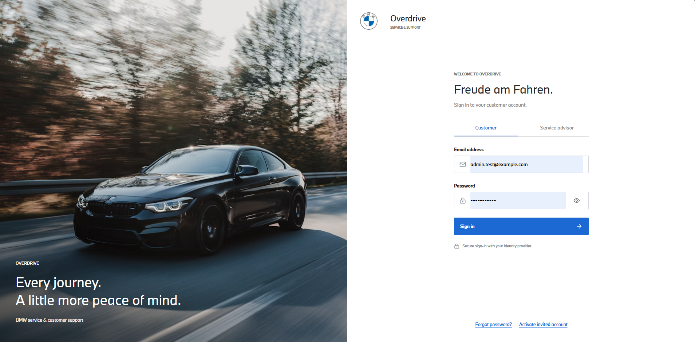
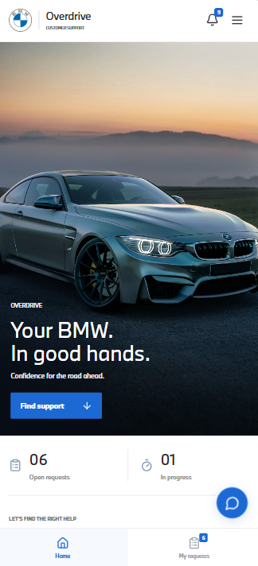
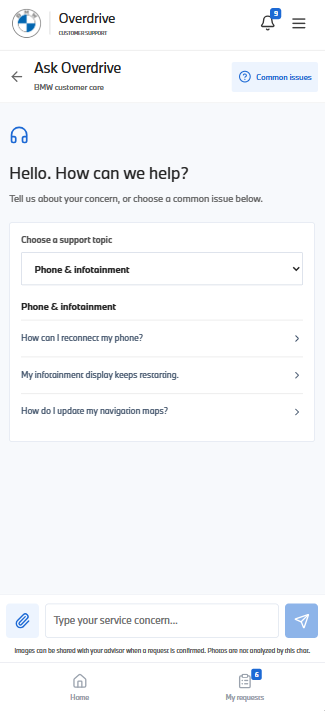
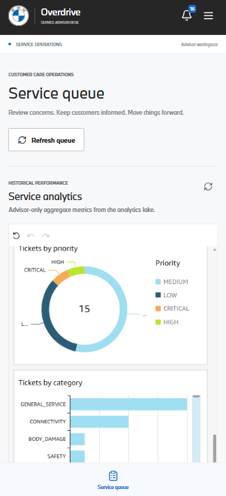

# Overdrive

A serverless, AWS-based vehicle service and support platform for customers and service advisors. Customers describe a concern in chat, get grounded self-service guidance from an **Amazon Bedrock AgentCore** service agent, optionally attach photos for **AI image analysis**, and escalate to a service ticket only when needed. Advisors work the ticket queue and see aggregate analytics.

## Contents

1. [What it does](#what-it-does)
2. [Screenshots](#screenshots)
3. [Architecture](#architecture)
4. [Repository structure](#repository-structure)
5. [Run locally](#run-locally)
6. [Tests and checks](#tests-and-checks)
7. [Deployment](#deployment)
8. [Documentation map](#documentation-map)
9. [Limits and notes](#limits-and-notes)

## What it does

| Capability | How it works |
| --- | --- |
| **Service agent (AgentCore)** | A knowledge-base-grounded Bedrock AgentCore harness answers questions with approved citations and keeps saved chat history per customer. Safety-related concerns skip self-service and offer a confirmed high-priority follow-up. |
| **Photo analysis** | JPEG/PNG/WebP evidence goes to a quarantine bucket and is analysed by a vision model (Amazon Nova) only on explicit request. The text observations feed the agent; verified photos are archived with the ticket once the customer confirms. |
| **Ticket management** | The backend assigns category and priority. Tickets keep status history, advisor assignment, internal notes and replies, with optimistic locking. Every new ticket with a VIN starts the diagnostics workflow. |
| **Notifications** | The tickets table stream feeds EventBridge: SNS emails advisors about new tickets and customer replies, and an SQS-driven Lambda emails customers (SES) about advisor-side changes. |
| **Backups** | Point-in-time recovery plus a daily EventBridge Scheduler export of the ticket tables to S3. |
| **Advisor analytics** | DynamoDB Streams, a redacting Lambda, Firehose, S3 Parquet, Glue, Athena and QuickSight. No customer identifiers or free text are stored in the analytics lake. |
| **Auth and delivery** | Cognito sign-in (authorization code with PKCE) for Customer and Service advisor roles. GitHub Actions deploy the frontend to S3 and CloudFront and the API to Lambda. |

### Customer and advisor journeys

- Ask Overdrive by typing a concern or choosing a common issue, read the referenced guidance, and mark it resolved without a ticket. Resolved sessions are listed under My Requests.
- When guidance does not resolve a concern, create a service request. The request page opens with the original question already entered.
- Create a direct ticket; category, priority and summary are assigned by the backend.
- Track tickets, status history and advisor responses.
- As an advisor, filter the queue, assign yourself, update status or priority, add internal notes, reply, and view analytics.

## Screenshots

### Sign in

Role-based login for customers and service advisors.

<p align="center">
  
</p>

### Customer and advisor experience

<table align="center">
  <tr>
    <td align="center" valign="top" width="33%">
      <br>
      <b>Customer home</b><br>
      Open and in-progress requests, notifications and a floating chat button.
    </td>
    <td align="center" valign="top" width="33%">
      <br>
      <b>Ask Overdrive</b><br>
      The AgentCore assistant with common-issue shortcuts and photo attachment.
    </td>
    <td align="center" valign="top" width="33%">
      <br>
      <b>Service advisor queue</b><br>
      Ticket queue plus aggregate analytics by priority and category.
    </td>
  </tr>
</table>

## Architecture

| Layer | Services |
| --- | --- |
| Frontend | React, TypeScript, Vite, S3, CloudFront |
| API | API Gateway HTTP API, Lambda (Node.js 22, Hono), Cognito |
| AI | Bedrock Knowledge Base, Bedrock AgentCore harnesses (text chat, visual guidance), Amazon Nova Lite, Amazon Rekognition; AgentCore Gateway for automated ticket actions defined but not activated |
| Data | DynamoDB (tickets, interactions, visual sessions), S3 (attachments, quarantine, daily table exports) |
| Events | DynamoDB Streams, Lambda, EventBridge rules, SNS (KMS), SQS with a dead-letter queue, SES, EventBridge Scheduler, existing Step Functions diagnostics workflow |
| Analytics | Lambda, Firehose, S3 Parquet, Glue, Athena, QuickSight |
| Infrastructure | CloudFormation, Terraform (analytics pipeline only), least-privilege IAM, GitHub Actions with OIDC |

- Current AWS architecture: [docs/overdrive-current-aws-architecture.drawio](docs/overdrive-current-aws-architecture.drawio) (open in draw.io; one page, with the inactive AgentCore ticket-action flow shown in grey), with a written walkthrough in [docs/overdrive-current-aws-architecture.md](docs/overdrive-current-aws-architecture.md). Boundaries and routing rules are in [docs/architecture.md](docs/architecture.md).

## Repository structure

The repository is an npm workspace monorepo (`frontend`, `backend` and `packages/*`).

```text
overdrive/
├── frontend/                          React + TypeScript + Vite web app
│   ├── src/
│   │   ├── App.tsx                    Routes and app shell
│   │   ├── main.tsx                   Entry point
│   │   ├── components/                Login, CustomerHome, Assistant (chat), CreateTicket,
│   │   │                              TicketList, TicketDetails, AdvisorActivity,
│   │   │                              QuickSightPanel, VisualSupport, Profile, PortalLayout
│   │   ├── lib/                       api.ts (typed client), auth.ts and auth-flow.ts (Cognito PKCE),
│   │   │                              chat.ts, visual.ts, images.ts, session.ts, support.ts
│   │   └── *.css                      Phone-first, tablet and desktop styles
│   ├── public/                        Brand assets and self-hosted fonts
│   └── tests/                         Frontend unit tests
│
├── backend/                           Serverless API, AI agent tools and analytics
│   ├── src/
│   │   ├── app.ts                     API routes, authorization, ticket lifecycle
│   │   ├── lambda.ts                  AWS Lambda entry point
│   │   ├── local.ts                   Local dev entry point with seed data and demo mode
│   │   ├── tickets/                   Memory or DynamoDB repository, optimistic locking
│   │   ├── triage/                    Safety-first rules and optional Bedrock classification
│   │   ├── knowledge/                 Demo FAQs and grounded-answer adapter
│   │   ├── agent-tools/               AgentCore gateway tools the service agent calls
│   │   ├── visual/                    Photo analysis: sessions, Nova vision calls, worker
│   │   ├── attachments/               Presigned S3 uploads and authorized downloads
│   │   ├── events/                    Tickets stream -> EventBridge domain events
│   │   ├── notifications/             Ticket actions: diagnostics workflow, customer emails
│   │   ├── analytics/                 Stream consumer (redaction), transforms, QuickSight embed
│   │   └── auth/                      Cognito token verification
│   ├── tests/                         Routing, lifecycle, authorization, visual, event and token tests
│   └── visual.Dockerfile              Container image for the visual support Lambdas
│
├── packages/
│   └── contracts/
│       └── src/index.ts               Shared Zod schemas, ticket types and enumerations
│
├── infra/
│   ├── cloudformation/
│   │   ├── frontend-hosting.yml       CloudFront, S3 hosting, Cognito client, deploy role
│   │   ├── backend-lambda-platform.yml  API, data, ticket events, notifications, backups
│   │   ├── ticket-gateway.yml         AgentCore gateway for ticket tools
│   │   ├── visual-agent.yml           Photo-analysis agent resources
│   │   ├── visual-support.yml         Visual API, queue, sessions table and workers
│   │   ├── analytics-platform.yml     QuickSight datasets and dashboard
│   │   └── terraform-state.yml        State bucket and lock table for the analytics Terraform
│   ├── analytics/                     Terraform: streams, Firehose, S3 Parquet, Glue, Athena
│   └── environments/                  Analytics Terraform backend config
│
├── scripts/
│   ├── deploy.mjs                     Release tool: status, infra change sets, releases
│   └── deploy/                        Its modules and unit tests
│
├── .github/
│   └── workflows/
│       ├── frontend.yml               Frontend pipeline (S3 and CloudFront)
│       └── backend.yml                Backend pipeline
│
├── docs/
│   ├── architecture.md                Boundaries and AWS service map
│   ├── api.md                         API routes and contracts
│   ├── deployment.md                  Pipelines, stacks, events, backups, analytics, visual support
│   ├── ui-foundation.md               UI requirements
│   ├── overdrive-current-aws-architecture.drawio   Current AWS architecture (draw.io)
│   ├── overdrive-current-aws-architecture.md       Walkthrough of that diagram
│   └── images/                        README screenshots
│
├── knowledge/
│   └── demo/                          Sample FAQ content (not approved documentation)
└── package.json                       Workspace root and npm scripts
```

## Run locally

Requires Node.js 22.12+ (Node 24 also works), npm and Git. From the repository root:

```powershell
npm ci
npm run dev
```

Open http://127.0.0.1:5173. The React app proxies `/api` to the local API on port 3001. Vite picks another port if 5173 is busy; if you change the API port in `backend/.env`, update the Vite proxy to match. See `backend/.env.example` for the variables.

Local development uses **demo mode**: choose Customer or Service advisor on the login screen and select **Enter demo**. Demo mode uses seeded tickets, in-memory storage, deterministic classification and labelled sample FAQs. Tickets reset when the API restarts. Demo identities are not real authentication, and uploads are disabled. No AWS credentials are needed locally.

## Tests and checks

```powershell
npm test                 # backend, frontend and deploy-script tests
npm run test:backend
npm run test:frontend
npm run typecheck
npm run build
```

Infrastructure checks (no AWS credentials needed):

```powershell
cfn-lint infra/cloudformation/*.yml
terraform -chdir=infra/analytics init -backend=false -input=false
terraform -chdir=infra/analytics validate
```

## Deployment

Changes under `frontend/` and `backend/` deploy independently from `main` through GitHub Actions. The frontend pipeline publishes to S3 behind CloudFront; the backend pipeline publishes the API, ticket-events and ticket-actions Lambdas. Documentation-only changes deploy nothing. Shared files (`packages/contracts`, the root lockfile, `tsconfig.base.json`) start both pipelines. `scripts/deploy.mjs` does the AWS work and uses OIDC, so no AWS keys are stored in GitHub.

```powershell
npm run deploy:status                 # deployed Lambda code, stream wiring and live health (read-only)
npm run deploy:infra -- backend       # preview the CloudFormation change set, confirm, apply (--plan-only to just look)
npm run deploy:backend -- --check     # preflight only
npm run deploy:backend                # check, build, publish the three Lambdas, smoke test
npm run deploy:frontend               # check, build, publish to S3, invalidate CloudFront, smoke test
```

Setup, verification and limits are in [docs/deployment.md](docs/deployment.md). The AWS account IDs, domains and resource names in the docs are placeholders; replace them with your own.

## Documentation map

| Document | Contents |
| --- | --- |
| [docs/architecture.md](docs/architecture.md) | Pain points, boundaries and AWS service map |
| [docs/overdrive-current-aws-architecture.md](docs/overdrive-current-aws-architecture.md) | Walkthrough of the current AWS architecture diagram |
| [docs/api.md](docs/api.md) | API routes and request/response contracts |
| [docs/deployment.md](docs/deployment.md) | Pipelines, CloudFormation stacks, ticket events, backups, analytics, visual support |
| [docs/ui-foundation.md](docs/ui-foundation.md) | UI requirements and boundaries |

## Limits and notes

This is a portfolio project, not a production safety or diagnostic system. Rule-based classification is conservative but not certified. AI output is a recommendation for human review, never a diagnosis.

Production use would still need an approved document corpus, cloud integration tests, malware and content scanning, SES production access and a verified sending domain, audit and retention policies, alarms and an MFA policy. Single-partition queue indexing and embedded conversations are MVP tradeoffs.

Never commit secrets, local `.env` files, Terraform state or customer evidence. Commit the lockfiles.

## Credits

The BMW Type Next fonts (`frontend/public/fonts`) and the BMW roundel (`frontend/public/brand/bmw-logo.png`) are the property of BMW AG and are used here for a non-commercial demonstration only. Overdrive is an independent project and is not affiliated with, sponsored or endorsed by BMW. App photographs load from Unsplash under the Unsplash licence.
